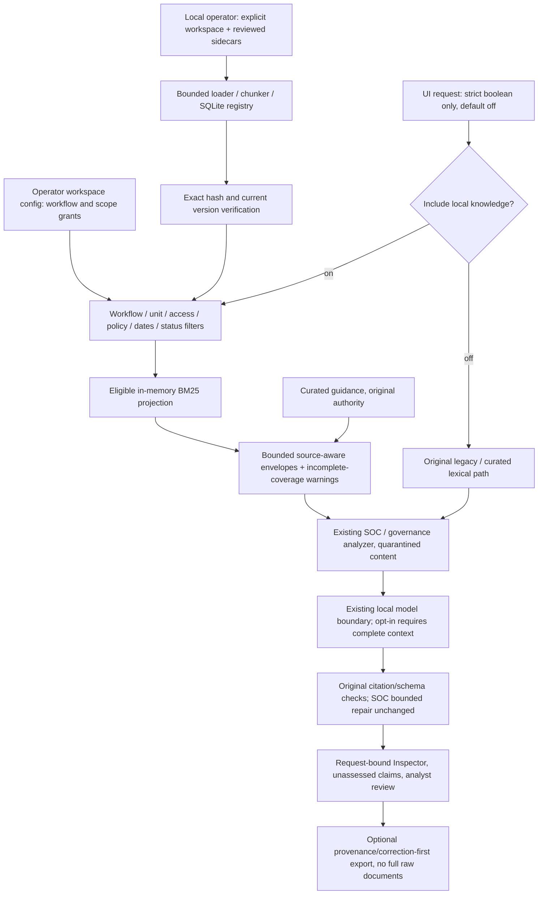

# Sprint 5: three-pillar knowledge foundation

Experimental, unmerged local development. Not a release or safety certification.
Implementation-authored synthetic checks are not independent expert validation.

## Starting state and checkpoints

Started on `feature/local-development-launcher` at
`6be3887617dfac1b95c09d672f5fa5acaabb9e08`, matching the live remote. Working branch:
`feature/three-pillar-knowledge-foundation`. Main/peeled v2.3.0 remain
`fde00d0ca5d21eecbc6973cc784550ed453edb7a`. No launcher or demo-clone changes.
The user-installed AGENTS.md was committed unchanged in the plan checkpoint;
its SHA-256 is `17269f4f2e115f2b0c161ccbfd8832fa176e9a2bf17a365440b0c7dd16814a3d`.

Protected inherited material: 405 untracked `evals/results/s4check/` files, with
user authorization to proceed around them. Their structure/metadata was inspected
read-only: no .git/redirect target/registered secondary worktree, root pytest only
discovers `tests/`, and root Ruff passes with the snapshot present. Their byte
hashes are frozen in the new preservation manifest. They remain untracked and
unmodified. Ignored logs/journals/registries, .env, .venv, caches and the preexisting
Ollama process are not repurposed. No Python evaluation process was observed.

Checkpoints: `9af0344` plan/preservation; `45a845d` synthetic sources and 26-case
freeze; `65b6587` pre-outcome LF hash portability correction; `0a9e766` registered
bridge and focused API tests. Later checkpoint identities and exact final CI are
recorded in the final handoff (a document cannot embed its own commit SHA).

## What works and what remains planned

| Pillar / layer | Actual status |
| --- | --- |
| SOC | Released Investigation core; unmerged bounded Microsoft file adapter; experimental registered-document integration |
| AI Security | Planned standalone Assessment; this sprint supplies the shared pipeline threat model and executable adversarial software tests |
| AI Safety, Assurance & Policy | Existing active AI System Risk Review; experimental document context, unchanged governance API identifiers |
| Shared evidence / assurance | Curated guidance retained; Inspector/corrections/reporting remain functional; new read-only Knowledge Workspace and CLI |
| Deferred | Standalone SOC Policy & Governance Review, authenticated upload portal, multi-user IAM, semantic entailment certification, dense/hybrid default migration |

Platform Evaluation is this application's self-evaluation view. Policy applicability,
source currentness and generated-answer correctness are separate questions. A
requirement is not evidence of deployed implementation or granted approval.

## Architecture and Python concepts



`app/knowledge_contracts.py` defines small immutable Pydantic contracts. Metadata
and scope grants come from an operator-reviewed sidecar/config, never document
prose or analysis request fields. A ContextVar is a request-local flag; its context
manager resets it even if retrieval or inference fails, preventing one request's
opt-in from affecting another.

`app/knowledge_workspace.py` resolves only simple workspace names beneath the
designated local root. It reuses the existing loader/chunker/registry/importer,
verifies reviewed full hashes and current registered versions, then filters before
BM25. No trust/index cache persists between requests. `build` validates and builds
a bounded in-memory projection, avoiding a second stale persistent index. The
registry remains the existing SQLite identity store, not an authorization database.

The orchestration hook adds local context only while the request flag is true.
UI request subclasses project the flag away before calling original analyzers;
public request/response schemas and direct evaluation seams stay unchanged. The
Inspector rechecks the trusted query and registry gate, records selected/cited
source provenance, and adds local eligible/selected coverage only on opt-in.
Existing no-knowledge report serialization remains unchanged.

`app/inference_context.py` also enables the existing no-truncation/no-shift local
runtime path for knowledge requests. This is needed for both workflows: a character
budget is not a token budget. An unsupported/oversized local runtime request is
withheld rather than silently evicting source material. Defaults remain unchanged.

## Trust and resource boundaries

- Only local operator CLI registration; no arbitrary-path API upload/read route.
  UI requests accept a strict boolean and reject paths, scopes, authority and other
  extra fields. The original public analysis routes remain compatible.
- Flat TXT/MD/PDF directory, at most 32 files; 1,000,000 bytes/file, 4,000,000 total;
  PDF at most 16 pages; extraction 32,000 characters/file and 128,000 total; 48
  chunks/file and 256 total. Nested directories, unsupported types, symlink/junction
  escapes and hard-linked documents are refused before ingestion.
- Metadata at most 200,000 bytes/file, strict known fields, duplicate-key rejection,
  full content hash and version binding. Missing/changed reviews and missing,
  corrupt, unregistered or stale registry records fail visibly. New documents
  default unapproved/unverified; registering never upgrades existing reviews.
- Ranking query at most 20,000 characters; serialized selected evidence at most
  24,000 characters, including bounded curated guidance. No context-size fallback.
  Local K remains the analyzer's existing 5/6; CLI/evaluation K is explicitly 8.
  Candidate omission is reported; selection does not certify complete coverage.
- Source content stays untrusted and passes the existing instruction heuristic.
  Body/title/model relevance cannot grant authority or access. Citation membership
  and registry checks do not establish entailment. There are no model-triggered tools.
- Status API returns only aggregate counts and eligible source identity/title/
  version/authority, not raw documents, local paths or hidden grants. Inspector
  exports omit full source excerpts. Titles, analysis and analyst notes may still
  be sensitive; review the entire export before sharing.
- This is single-user, unauthenticated local advisory software. Scope eligibility
  is not enterprise IAM/RBAC; concurrent operator file/registry edits are not a
  transactional authorization snapshot. Do not edit a workspace during analysis.
- A forged source reference is removed and metadata restored, but arbitrary model
  prose can still be wrong. Governance retains its narrower semantic checks. No
  accuracy/confidence/safety percentage or independent validation is asserted.
- Existing SOC critical-identifier checks remain bound to supplied telemetry.
  An address appearing only in an eligible asset document does not become an
  observed event fact; repeating it in generated case text can still trigger the
  existing repair/withholding contract. No broader identifier migration or live
  positive-information retention claim is made here.

## Synthetic Northstar walkthrough

The versioned `sample_data/knowledge_demo_v1/` pack describes the fictional
Northstar Learning Cooperative. It has eight document files: SOC response playbook,
access/incident policy, separate implementation note, asset context, RAG design,
expired policy, conflicting current guidance and an unapproved malicious sample.
Seven reviews are approved, but the expired/inactive policy is ineligible. The
poison sample stays unapproved in the normal demo. A separate approved-unverified
test deliberately admits it to verify instruction quarantine and authority handling.

`assets.json` explicitly lists three assets, two TEST-NET subnets and one directed
read-only RAG-to-catalog dependency. No rendered map is used to infer graph edges.
The Microsoft-format case has exact alert/evidence IDs and two different accounts:
an operator failure and inventory-service success. Scheduled maintenance is a
legitimate alternative, not a verified explanation. Change approval, deployed
control tests and completion evidence are deliberately missing. Conflicting guidance
does not override the scoped policy's human approval requirement.

All identities/domains/IPs are synthetic. The pack reuses existing supported input
tables; it is not an Entra/Defender/Sentinel connection or full vendor-schema claim.
Official field references are linked in [Microsoft input documentation](27_microsoft_security_inputs.md),
including Microsoft's [SigninLogs schema](https://learn.microsoft.com/en-us/azure/azure-monitor/reference/tables/signinlogs)
and [advanced hunting tables](https://learn.microsoft.com/en-us/defender-xdr/advanced-hunting-schema-tables).
No proprietary manual or live intelligence was imported.

From a full development clone with existing dependencies, choose a **new** name;
initialization refuses to overwrite an existing workspace:

```powershell
.\.venv\Scripts\python.exe -m scripts.knowledge_workspace init northstar --demo
.\.venv\Scripts\python.exe -m scripts.knowledge_workspace register northstar
.\.venv\Scripts\python.exe -m scripts.knowledge_workspace build northstar
.\.venv\Scripts\python.exe -m scripts.knowledge_workspace status northstar
.\.venv\Scripts\python.exe -m scripts.knowledge_workspace query northstar --workflow soc_investigation --text "incident containment approval procedure"
.\.venv\Scripts\python.exe -m scripts.knowledge_workspace query northstar --workflow ai_system_risk --text "RAG retrieval prompt tool boundaries implementation approval"
```

For private operator onboarding, use `init <new-name>` without `--demo`, copy only
intended TXT/MD/PDF files into its `documents/` folder, then `register <name>`.
The generated `reviewed.json` contains exact identities and defaults to unapproved,
unverified material. Inspect each document and review metadata separately. Set
approved true only deliberately, and assign workflow, owner, sensitivity, authority,
policy scope, applicability/access requirements and dates in that sidecar. Set
operator grants in `workspace.json`. An empty config grants no workflow. Review
file changes again; registering a changed version does not rewrite or reapprove an
old review. Do not put private documents/metadata in tracked fixture directories.

For a manual **foreground** backend using the existing venv and installed model:

```powershell
$env:LOCAL_KNOWLEDGE_WORKSPACE = 'northstar'
.\.venv\Scripts\python.exe -m uvicorn app.main:app --host 127.0.0.1 --port 8000
```

In another foreground terminal use the existing Streamlit command. No launcher
defaults or shared Ollama processes need changing. This sprint itself starts no
server and makes no real model request. Users should submit a case once and check
Activity before retrying a timed-out request.

Human walkthrough: inspect Knowledge Workspace, open SOC Investigation, choose
Microsoft telemetry and paste `soc-case.json`. Review exact IDs/accounts in the
preview; analyze once with knowledge off, then intentionally enable knowledge for
a separate submission. Inspect source version/authority, selected versus cited
chunks, omission warnings, field anchors, evidence gaps and unassessed claims.
Use `ai-risk-request.json` to populate AI System Risk Review and inspect the same
distinctions. Review the missing approval/implementation evidence. Record a correction,
revise it, and inspect correction-first JSON/Markdown without changing original inputs.

Technical AI Security test (no third analyzer): run the poison API tests below.
They deliberately approve only synthetic unverified poisoned text in a temporary
workspace, then inspect the actual serialized/quarantined prompt and sanitized
source metadata. A deterministic stub cannot demonstrate real model resistance;
it demonstrates application boundaries and source handling.

## Evaluation and verification

Baseline CPython 3.13.1/Windows: **1792 passed, 4 failed**, one existing
Starlette/httpx warning, 90.85 s. All failures were old guards rejecting the
user-replaced AGENTS.md; no application baseline failure was concealed. Ruff,
pip check and diff check passed. Historical scope checks now use fixed original
commit ranges with unchanged old allowlists. Named source edits use pre-sprint
identities; protected historical data/scorers/reports remain live hash-checked.

The new case/plan/source freeze was committed before outcomes. Gold is synthetic,
implementation-authored, not independently human adjudicated. The runner reports
Recall@8, group coverage, false eligible exposure, related no-answer retrieval,
positive retrieval loss, status consistency, refusals and elapsed time separately.
Generated-answer correctness, unsupported-answer tendency and positive generation
loss are **NOT MEASURED**. Live Ollama/qwen calls: **0; NOT RUN**. No embedding,
cloud or network evaluation calls. No statistical model-reliability claim.

```powershell
.\.venv\Scripts\python.exe -m pytest -q tests/test_knowledge_workspace.py tests/test_knowledge_bridge.py tests/test_knowledge_ui.py
.\.venv\Scripts\python.exe -m evals.knowledge_bridge_v1.runner --output evals/results/knowledge_bridge_replay.json
.\.venv\Scripts\python.exe -m pytest
.\.venv\Scripts\python.exe -m ruff check .
.\.venv\Scripts\python.exe -m pip check
git diff --check
```

The runner creates output exclusively and refuses to overwrite an existing report.
Only new temporary synthetic workspaces are created during evaluation. Official
new results and final counts are recorded below. Frozen
historical evaluations are never rerun live, relabeled, tuned against or rewritten.

Intermediate development checks are retained honestly: one UI/bridge batch had
108 passed / 3 failed (two poison assertions plus the not-yet-created report link).
A two-case diagnostic confirmed an escaped-newline quarantine gap. The opt-in
serializer now quarantines actual document payloads before JSON escaping, retaining
original evidence/hashes for inspection; both regressions pass. This is an invocation
ordering fix, not a new heuristic trained on historical judgments. The report link
was supplied. The next focused batch passed 121 tests, one existing warning.
Early scoped Ruff failures were import/fixture/nested-with style errors; all were
corrected. One exploratory shell Python command had a quoting SyntaxError and made
no changes. No failed intermediate check is presented as a passing run.

Offline attempt 001 at `5c872e8` failed during Windows temporary-directory cleanup
because its registry-mutation fixture did not close a SQLite connection. No complete
report or partial per-case journal was written, so no partial pass count is claimed.
The failure and temporary remnant are preserved in `knowledge_bridge_v1/attempt_001_failure.json`.
The fix explicitly closes that fixture connection; no source, ranking, case, expected
result or score changes. The original implementation freeze remains intact, with
a separate execution-fix hash committed before the full-suite retry. This is a
deterministic infrastructure retry, not a selective example rerun or live inference.

## Completed offline evidence and final local validation

The complete recorded evaluation ran at
`30de7f4846e7b8b39a6659c9e0a00023800ec343`. See
[unaltered results](knowledge_bridge_v1/results.json),
[artifact identities](knowledge_bridge_v1/result_identity.json), and
[exact changed-file inventory](knowledge_bridge_v1/change_inventory.json).

| Separate measure | Result / denominator |
| --- | --- |
| Authored contract cases | 26/26 satisfy their predeclared assertions |
| Relevant document-target Recall@8 | 13/13 targets across 11 positive cases |
| Required-group coverage | 2/2 groups in one multi-source requirement/procedure case |
| Forbidden eligible exposure | 0 sources across 10 declared exclusion cases |
| No-answer nonempty retrieval | **1/2** queries: related incident guidance cannot supply the missing deadline |
| Positive retrieval loss | 0/13 declared targets |
| Support status consistency | 23/23 returned selections remain unassessed |
| Expected safe workspace refusals | 3/3 (changed bytes, missing registry identity, forged ID) |
| Real generation / embedding / network calls | 0 / 0 / 0 |
| Generated unsupported-answer tendency / positive generation loss | NOT MEASURED |

The targets are authored document identities, not exhaustive relevance judgments
over every chunk in a real organization. Requirement/procedure coverage tests two
distinct chunks. The **1/2 no-answer counterexample remains a limitation**, even
though the declared contract cases pass: lexical relevance does not establish
answerability. There is no learned abstention threshold or automatic free-prose
support certification. The requirement/implementation/approval cases verify
retained unassessed status and provenance, not a semantic theorem about model text.

Recorded per-case elapsed time includes fresh temporary workspace registration:
median 177.4725 ms, range 97.721–208.242 ms, sum 4656.526 ms. Whole runner command
took 5.62 s. These are local software timings, not inference latency or controlled
backend comparisons. No paid model/API request occurred; CPU/electricity costs were
not measured. No qwen outputs or independent human judgments are claimed.

Local execution count: one incomplete infrastructure attempt (partial case count
unavailable), one complete official 26-case run, one complete focused offline replay,
and one complete replay in each of the two full deterministic validation runs:
**104 completed case checks across four full executions**, with no selective rerun
or altered expectations. The second full validation follows the policy-test-only
portability correction; application/evaluation source and outcomes are unchanged.
Hosted CI performs its own fresh deterministic replay, reported separately in the
final handoff. Historical vector/ranking/Inspector replays ran offline in the full
suite; historical live evaluations and original artifacts were not modified.

Implementation verification with the existing Windows CPython 3.13.1 venv:

- `.\.venv\Scripts\python.exe -m pytest -q`: **1876 passed**, one existing
  Starlette/httpx deprecation warning, 95.05 s. No skips or failures in that run.
- Final portability-checkpoint full run of the same command: **1877 passed**,
  one existing warning, **94.01 s**, no skips/failures. The additional test binds
  canonical policy text to the original policy checkpoint and checks transport
  equivalence without modifying the installed file.
- Focused UI/bridge/Microsoft/Inspector/preservation batch: **121 passed**, one
  existing warning. Earlier core retrieval/correction/report batch: **134 passed**.
- New frozen evaluation/artifact replay: **4 passed**, 5.70 s before the full suite.
- Final post-report policy/historical/scope recheck: **7 passed**, 4.06 s.
- `.\.venv\Scripts\python.exe -m ruff check .`: passed.
- `.\.venv\Scripts\python.exe -m pip check`: no broken requirements.
- `git diff --check`: passed. No dependency, launcher, original schema/analyzer/
  prompt, reference-card or frozen historical artifact diff. New freeze hashes and
  installed AGENTS.md hash passed; protected preexisting 405 file hashes passed.
- Git reported stale stat entries on nine new LF-normalized fixture files despite
  no content diff. Each was verified byte-identical to HEAD before an explicit
  index refresh; no source/expected-result bytes changed and no staged diff resulted.

The actual CLI walkthrough used the new ignored workspace **northstar-sprint5**:
`init --demo`, `register`, `build`, `status`, and SOC/AI-risk `query` all exited 0.
It contains eight registered documents/chunks, seven approved reviews, and six
currently eligible chunks for each configured workflow. The SOC walkthrough query
selected five and explicitly reported one omitted eligible chunk; the AI query
selected six. These are query-specific results, not complete-case support claims.
`git check-ignore` confirms its configuration and registry are ignored. This new
synthetic workspace remains available for user inspection; no inherited workspace
was touched. `status northstar-sprint5` is safe to run again; do not reinitialize it.

All changes are confined to the authorized feature branch. Final tracked diff must
be clean before each authorized non-force feature push; protected s4check remains visibly
untracked. Final exact commit SHA and GitHub Actions URL/status are given in the
handoff after the push. Main/tag, release clone, permissions, dependencies, OS
settings and shared processes remain unchanged; no merge/tag/release or PR action.

## Hosted portability follow-up

The initial pushed checkpoint `745fc28b1550d795c488eb4cb8a7da8dc9d911c2` had
[failed exact-SHA CI](https://github.com/akshayneal/local-ai-security-risk-platform/actions/runs/41014190104).
Tests failed and Ruff was skipped. Public run/jobs/check metadata was readable;
log download returned HTTP 403, so hosted pass/fail/skip counts were unavailable.
No credential access, permission change or workflow rerun was attempted.

A concrete portability defect was reproduced from the committed bytes: this
checkout's installed AGENTS.md has mixed line endings and SHA-256 `17269f4...`,
whereas Git stores identical text with LF SHA-256
`265a373d73215ebfe02a21f313f4b71efb57f815fc430b6f5c524888b51310fc`.
The newly authored raw-byte assertion necessarily fails on an LF checkout.
The fix preserves the original exact-byte check wherever this protected inherited
snapshot exists, and always checks exact normalized policy text against the
unchanged `9af0344:AGENTS.md` checkpoint. A fresh-clone regression checks LF/CRLF
transport equivalence and rejects changed policy text. The installed file itself
remains byte-identical. No historical hash, expected case, scorer or model result
changed. See [preserved failed CI metadata](knowledge_bridge_v1/ci_001_failure.json).

This required one bounded additional checkpoint/push on the same authorized branch
after the initial push, rather than a history rewrite or stable-branch change.
Without initial logs, the defect is not asserted to be its sole failure; the final
exact-SHA run determines hosted status. The final handoff supplies that SHA/URL.
Focused portability checks: 4 passed, 2.42 s. Final full suite: 1877 passed,
one existing warning, 94.01 s; Ruff, pip check and diff check passed. No production
module, frozen case/source/scorer/result or policy-body change follows those gates.

## Human-only review and next scope

**USER VISUAL QA PENDING.** Start/stop the development launcher manually using
its existing instructions; verify the release shortcut still targets main/version
2.3.0. The agent did not open/control apps or shortcuts. Inspect Overview/About in
light/dark themes and narrow widths, exactly two active pages, Planned AI Security,
knowledge status/checkbox/error messaging, both analyzers' Inspector and no-answer
warnings, field anchors, revision history and correction-first downloads. Test
expired/wrong-scope/malicious synthetic documents, never real private materials
in public screenshots. Independent user review of fixed positive/negative cases
and the requirement/implementation distinction remains outstanding.

Next sprint, in priority order: define a typed technical AI Security Assessment
input (assets, dataflows, retrieval/tool boundaries); freeze benign and adversarial
cases with independently reviewed judgments; implement a bounded advisory threat
assessment behind a distinct planned-to-experimental gate; test evidence provenance,
positive loss and tool permission boundaries. Do not turn this sprint's navigation
or synthetic software results into proof of a functioning third analyzer.
