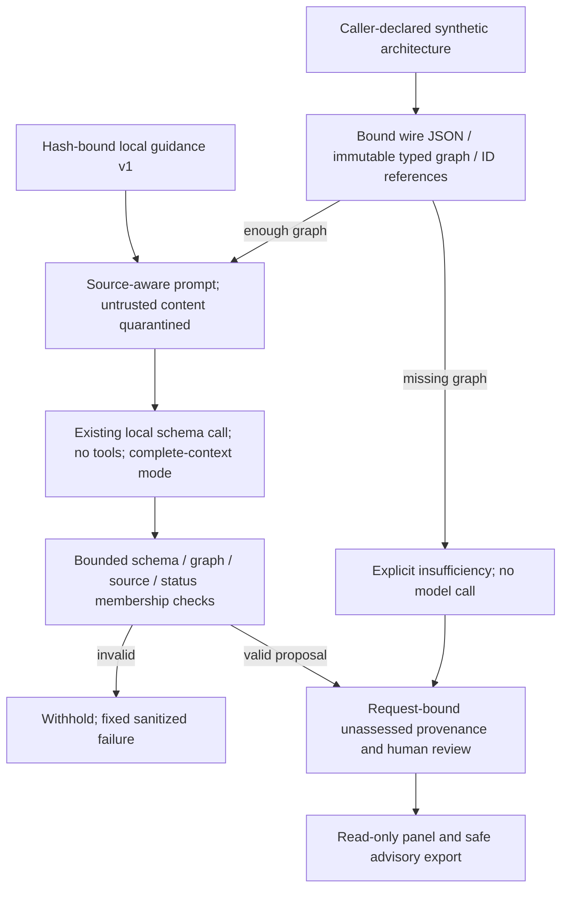

# Sprint 6: technical AI Security Assessment

Experimental, unmerged advisory workflow. No penetration test, exploit execution,
control verification, deployment approval, certification or release is claimed.

## Baseline and preservation

Started on `feature/three-pillar-knowledge-foundation` at
`a43814b43df9bd677469f002c785ac0710c4404d`, matching the live remote with zero
divergence. Stable main/peeled v2.3.0 remain
`fde00d0ca5d21eecbc6973cc784550ed453edb7a`. Created the previously absent
`feature/ai-security-assessment-v1` from that exact base.

The 405 inherited untracked files match the Sprint 5 manifest and remain visibly
untracked, isolated from pytest discovery, unmodified and unstaged. The existing
`northstar-sprint5` ignored workspace has 13 files including eight source documents,
config/reviews and SQLite database/WAL/SHM. Hashes were recorded without opening
SQLite; this sprint never initializes, registers, queries or writes that workspace.
AGENTS.md remains byte-identical, SHA-256
`17269f4f2e115f2b0c161ccbfd8832fa176e9a2bf17a365440b0c7dd16814a3d` in this checkout.
No inherited Python evaluation process was observed. Existing services, logs,
journals, .env, .venv, caches, launchers, main, tags and prior branches are preserved.

Baseline: existing CPython 3.13.1 Windows AMD64 venv, **1877 passed**, one existing
Starlette/httpx deprecation warning, 95.44 s. Uncached Ruff/pip checks passed.
Commands use Python -B, pytest without its cache provider and Ruff --no-cache.
No new dependency, model download, environment replacement or service start.

`bcc8b31` committed the plan/preservation contract. `883e977` committed the 24
cases, examples, rubric and versioned guidance before evaluation outcomes. Later
implementation/report checkpoints and the exact final SHA are listed in the handoff
and machine-readable change inventory; a report cannot contain its own commit SHA.

Historical migration changes only Sprint 5's changed-path comparison end to fixed
`a43814b...`, retaining its original allowlist and all other policy/hash/snapshot
checks. A new regression compares every executable AST node to the immutable
original, permitting only that added end argument. The new Sprint 6 manifest freezes
all other base blobs and the protected workspace. Earlier frozen cases, scorers,
judgments and result bytes remain unchanged.

## What runs and why there is an explicit gateway

SOC Investigation handles supplied telemetry. AI System Risk Review handles
AI-system governance, policy applicability and oversight. AI Security Assessment
now handles a **technical declarative architecture**: assets, directed flows, trust
boundaries, ingestion, tool agency, data disclosure and downstream consumption.
It returns candidate hypotheses and proposed validation, without governance
approval/decision semantics. Three pillars remain; this third workflow is labeled
Experimental, while the two established workflows retain their Active labels.

Sprint 5's frozen replay binds `app/main.py` to its exact source identity. Rather
than weaken that experiment or alter its runner, `app/ai_security_api.py:app`
composes the original routes and one new `POST /ui/analyze/ai-security` route.
Original `app.main:app`, schemas, prompts, analyzers, inference boundary and launchers
remain unchanged. Existing launchers therefore **do not activate this gateway**.
The new page visibly states the explicit foreground gateway requirement. This is
the same underlying local model boundary and original routes, not a second provider
or hidden default migration. A legacy backend lacks this new route and cannot
execute the assessment; it does not silently fall back to another analyzer.

Third-pillar organizational knowledge is **unsupported/deferred**. The request
rejects workspace, local-knowledge, access/policy grants and authority fields. It
cannot acquire SOC/AI-risk documents through prose or model output. Existing
WorkspaceConfig and all prior reviews/eligibility remain unchanged.

## Python and trust model walkthrough

`app/ai_security_contracts.py` uses immutable Pydantic models and tuples. The
request represents application purpose/assumptions, actors, components, directed
flows, ingestion surfaces, declared tool capabilities/invokers/human gates, claimed
controls, separate caller-supplied unverified implementation evidence and oversight.
IDs are short uppercase identifiers, globally unique among design objects. A flow
is an explicit directed edge between existing component IDs; no image, diagram or
language model invents those edges. Tool invokers and control/evidence dependencies
must exist. A stated boundary or control is a submitted claim, not real permission.

Limits: 8 actors, 16 components, 24 flows, 8 ingestion surfaces/tools, 16 controls/
implementation-evidence records. Descriptive strings are at most 400 characters,
names 128, IDs 32; note lists at most 8. Complete normalized input at most 20,000
UTF-8 bytes. Wire body is capped at 24,000 bytes before JSON parsing; duplicate keys,
invalid/nonfinite JSON and malformed/extra fields are rejected with fixed errors.
No arbitrary-path reader, URL fetcher, credential field, graph dependency or tool
executor is introduced.

`app/ai_security_sources.py` loads exactly six locally authored, hash-bound guidance
cards in `reference_material/ai_security_v1/`. Version:
`local-ai-security-guidance-v1`; authority: local reference guidance. The categories
are prompt injection, retrieval poisoning, sensitive disclosure, excessive tool
agency, broken authorization and unsafe downstream output consumption. These are
**local categories, not external OWASP/MITRE/NIST controls**, legal requirements or
organizational policy. No unversioned standard/feed was fetched. Missing, corrupt,
wrong-version/workflow guidance fails visibly; no other-workflow fallback.

`app/ai_security_analyzer.py` reuses existing source records, eligibility,
source-aware serialization, source provenance and the local JSON-schema model call.
Prompt-only copies are quarantined before JSON escaping; original request identity
is retained. The existing complete-context mode requires the loopback runtime with
no truncation/shift, and resets on success or failure. This experimental path
requires configured `qwen3:8b`; it never downloads a model or starts Ollama.
Prompt context is capped at 28,000 bytes, response at 24,000 bytes and 12 findings.
Character/byte caps are not token-retention or semantic-correctness guarantees;
the runtime may withhold an unsupported/oversized request.

Each finding references existing component/flow/control/evidence IDs. Named flows
must have both endpoint IDs included. Duplicate findings/IDs/references, unknown
sources, mismatched local source categories, wrong application IDs and forged
verification/approval fields fail closed without an extra output repair. The
existing provider's bounded transport retry remains unchanged; no live call occurs
in deterministic tests. The model schema uses `source_references` for citation
values, consistent with the existing system prompt; the precommitted stub spelling
`source_ids` is a validation alias. Supplying both is rejected as ambiguous.

All findings are `candidate` / `not_verified`; the result is `no_actions_executed`.
Application-owned metadata records unassessed claims, caller-supplied design
provenance, request/result fingerprints, selected/cited source provenance and human
review. Known missing implementation/oversight/boundary evidence is added without
silently discarding model gaps; an overflow is withheld. Empty/missing graph yields
explicit insufficiency without a model call. A benign design can return no findings,
but this is not proof that it is safe or deployed controls work.

Free-form model prose can still be wrong or contradict its intended hypothesis
framing. These checks do not establish general entailment, attack-path feasibility,
framework precision or model injection resistance. Fingerprints correlate records;
they are not authentication, anonymization or signatures.

`app/ai_security_api.py` bounds only the new route and returns sanitized errors.
Audit summaries use a request hash and fixed outcome/error strings, not raw design,
model output, private paths or provider error bodies. The hash itself is not privacy
protection. Original endpoint behavior is unchanged by composition.

`dashboard/ai_security.py` provides a bounded JSON editor, fixed synthetic examples,
component/flow summaries, hypotheses/gaps, claimed controls versus separate evidence,
read-only unassessed source panel and JSON/escaped-Markdown exports. Export binding
rejects a report from another request or altered provenance. It does not export the
full original request or prompt; summarized flows and model text may still be
sensitive. Review the whole export before sharing; it is not redacted. Existing
Inspector workflow/correction identities are intentionally not extended: this new
workflow has no correction editor or persistent review store yet.



## User-only synthetic walkthrough

The fictional examples are `rag.json`, `benign.json` and `insufficient.json` under
`sample_data/ai_security_demo_v1/`. No real organization data or credential is used.
The RAG example has unreviewed ingestion and declared flows; supplied controls and
design notes remain unverified, not a deployed finding or approved change.

Use two foreground terminals and unused loopback ports. These commands were not
used to start services by the implementation agent:

```powershell
.\.venv\Scripts\python.exe -m uvicorn app.ai_security_api:app --host 127.0.0.1 --port 8246
```

```powershell
$env:API_BASE_URL = 'http://127.0.0.1:8246'
.\.venv\Scripts\python.exe -m streamlit run dashboard/streamlit_app.py --server.address 127.0.0.1 --server.port 8536
```

Open AI Security Assessment, review/load the synthetic RAG example, inspect its
actual components/edges and submit once. Compare hypotheses to the supplied design;
verify source version/category, unassessed statuses and missing evidence. Try the
benign and insufficient examples separately. Inspect JSON/Markdown sharing notices.
An API-only **user-run actual inference** example (not executed by Codex):

```powershell
$design = Get-Content -Raw -Encoding UTF8 sample_data/ai_security_demo_v1/rag.json
Invoke-RestMethod -Uri http://127.0.0.1:8246/ui/analyze/ai-security -Method Post -ContentType 'application/json' -Body $design
```

Do not run that against the old app.main backend, and do not change or reinitialize
`northstar-sprint5`. Existing launcher shortcuts/main release remain as before.

## Frozen software evaluation and actual verification

24 cases, four groups of six, committed before recorded outcomes. Gold/stub responses
are implementation-authored synthetic checks, not independent human adjudication.
The actual route is exercised through TestClient; model calls and audit writes are
stubbed, with no Ollama, network service or protected workspace writes. Input
rejection, invalid output withholding, allowed source/category membership, benign
preservation, insufficiency and missing evidence are counted separately. Accepted
stub categories do not measure a real model's threat identification or precision.
All frozen input/source/rubric and implementation hashes are checked before replay.

**LIVE INFERENCE NOT RUN (0)**. No real generation attempts, repairs, embeddings,
model downloads, cloud calls, network scans or tool actions. Semantic accuracy,
positive model-answer loss and live injection resistance are NOT MEASURED. Python
route/test runtimes must not be reported as model inference time.

Reproduction with the existing venv:

```powershell
.\.venv\Scripts\python.exe -B -m pytest -q -p no:cacheprovider tests/test_ai_security_contracts.py tests/test_ai_security_workflow.py tests/test_ai_security_ui.py tests/test_sprint6_preservation.py
.\.venv\Scripts\python.exe -B -m evals.ai_security_v1.runner --output evals/results/ai_security_v1_replay.json
.\.venv\Scripts\python.exe -B -m pytest -q -p no:cacheprovider
.\.venv\Scripts\python.exe -B -m ruff check --no-cache .
.\.venv\Scripts\python.exe -B -m pip check
git diff --check
```

The runner refuses to overwrite an output. Official results, hashes, exact run
counts, final local gates and final exact-SHA CI are recorded below/in the handoff
after execution. No historical live evaluation is repeated or relabeled.

Development issues retained: two new preservation-comparator runs each had 1 failed /
6 passed: the first compared formatting tokens including trailing commas, the second
selected the cached-diff call instead of the BASE diff. The final AST comparison
matches only the intended call and preserves every other executable node; seven
focused preservation tests then passed. A nested-condition Ruff finding and import/
loop-closure style issues in new files were corrected with scoped edits. Some
atomic patch attempts had context mismatches and made no changes. No old hash,
allowlist or frozen expected outcome was weakened to fix these implementation checks.

Focused implementation checks: 77 passed (contracts/backend/UI/current preservation),
one existing warning, 6.28 s. Compatibility/navigation/historical replay selection:
67 passed, one existing warning, 12.27 s. Production navigation was changed to
Experimental only after backend and independent no-model UI checks passed.

## Human acceptance and final hardening

The user's earlier UI look was a **provisional visual smoke observation only**.
Existing SOC/governance workflows, actual local-knowledge retrieval and generated
outputs have NOT been manually accepted. This is a release blocker, not a reason
to stop isolated experimental implementation. **USER VISUAL QA PENDING** for this
new workflow: narrow width, themes, long JSON/errors, source provenance, benign/
insufficient messages, atomic form submission, stale-result clearing and exports.
No browser, desktop automation, screenshot, shortcut or real service was controlled.

Minimal closeout: independently review fixed synthetic hypotheses and positive losses;
test actual local-provider success/withholding and all three workflows end-to-end;
resolve any source/semantic/UI counterexamples; review privacy/audit/export behavior.
Only then consider a separately authorized portfolio/release decision. Keep optional
AI Security organizational knowledge and correction editing separately scoped with
new reviewed grants/fixtures. Do not expand framework breadth or claim certification
to conceal missing human acceptance.
