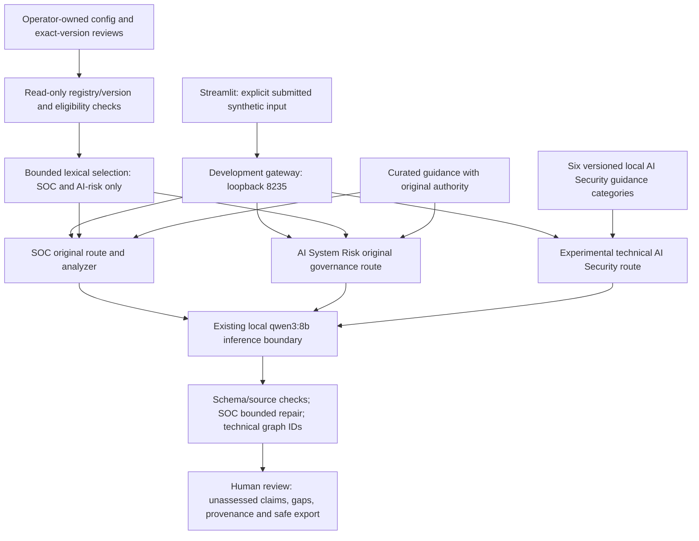

# Sprint 7: three-pillar integration and RC readiness

Experimental, unmerged local development. This is an evidence package, not a
release or independent safety validation. **NO-GO for eventual release candidacy:**
all four live technical advisories were withheld, semantic overstatements remain,
and human workflow/final visual acceptance is pending.

## Identity, scope and preservation

Start: `feature/ai-security-assessment-v1` at
`1c4f937f2b067a4a2b0d8ac8cf5db4f552555d00`, matching origin.
Work: `feature/cross-pillar-rc-hardening`. Main and peeled v2.3.0 remain
`fde00d0ca5d21eecbc6973cc784550ed453edb7a`. No merge, tag, release, PR, stable
branch push, shortcut installation, release-demo change or real service launch.

The original 405 snapshot files, the separately authorized 185 ignored cache
files, all 13 Northstar files and installed AGENTS bytes remain protected by exact
hashes. No s4check code is imported/executed; pytest discovers only root tests.
Northstar is hashed as ordinary bytes, never opened through SQLite or queried.
No inherited journal/evaluation was active; shared Ollama remains untouched.
No .env, .venv, dependency, OS, permission, account or ignore-rule change.

Baseline on Windows 11 build 26300 / PowerShell 5.1.26100.9711 / existing CPython
3.13.1 AMD64 venv: 1958 passed, one existing Starlette/httpx deprecation warning,
101.02 seconds. Ruff, pip and diff checks passed. Bare python was the Windows
Store alias, so every Python command uses the existing explicit venv and `-B`.
Local packages: FastAPI 0.138.0, Starlette 1.3.1, Pydantic 2.13.4, Streamlit
1.58.0, Ollama SDK 0.6.2, httpx 0.28.1, requests 2.34.2, pytest 9.1.1 and
Ruff 0.17.2. No package was installed or upgraded.
The initial cache discovery caused a preservation stop; explicit user permission
cleared Gate 0 without rerunning that baseline.

[Frozen scope](50_cross_pillar_rc_hardening_plan.md),
[current preservation manifest](sprint7_preservation.json),
[exact change inventory](cross_pillar_v1/change_inventory.md).

## What is implemented

| Pillar/layer | Working development path | Limits/status |
| --- | --- | --- |
| SOC | Generic telemetry and bounded Microsoft JSON/CSV adapter; original SOC analysis/repair, Inspector and correction-first exports | Core released on main; adapters/retrieval/Inspector remain unmerged; no SIEM connection or response execution |
| AI Safety, Assurance & Policy | AI System Risk Review via original governance route; reviewed local-knowledge opt-in and Inspector | Governance semantics prompt-guided; proposed review decision is not deployment approval |
| AI Security | Typed declarative architecture, six locally authored guidance categories, bounded candidate findings, read-only provenance, JSON/Markdown exports | Experimental; no exploitation, deployed-control verification, organizational-document access or correction editing |
| Development integration | One ASGI gateway `app.ai_security_api:app`, API 8235, UI 8535 | Existing shortcut targets; strict legacy-state migration; actual shortcut acceptance pending |
| Knowledge | Operator CLI registration and exact-version reviews, eligibility before lexical ranking, read-only status API/UI | Default off; SOC/AI-risk only; single local user, no authenticated IAM/RBAC; related source is not an answer |
| Deferred | Standalone SOC Policy workflow, authenticated portal, dense/hybrid default, external integrations | Planned; no execution route added |

`app.main:app` and all original public `/analyze/*` routes remain byte-compatible.
The composed gateway includes the old router and adds `/ui/analyze/ai-security`.
An ASGI gateway is the Python object Uvicorn serves; including a router connects
existing request handlers without copying or changing their analyzers. The
development launcher now selects this object. Main/v2.3.0 and `scripts/demo/`
still describe the stable two-workflow release.



Raw telemetry, document bodies, architecture claims and generated text are
untrusted data. Only application/operator metadata controls source identity,
eligibility, scope, currentness and authority. The model has no tools, filesystem
grant or operational permission. A requirement is distinct from implementation
evidence, a model recommendation from authorization, and a citation from entailment.
Hashes bind an evidence version for comparison; they are neither signatures nor
anonymization. Original evidence and existing correction lineage are preserved.

## Launcher migration and deterministic regression evidence

Five newly written migration checks failed against the original launcher before
the implementation: new command selection, legacy readiness, early legacy Start
refusal, and new-state acceptance were missing. The scoped change adds one fixed
legacy API command, accepts it only when reading old records for safe Stop, and
rejects legacy state before child discovery, state rewrite, reuse or automatic Stop.
New launches exclusively use the composed gateway. The UI command/ports are unchanged.

Stop retains exact executable/arguments, creation time and parent checks, plus
bounded verified child adoption. PID alone is unsafe because Windows can recycle
it. Legacy compatibility does not adopt port occupants or arbitrary module names.
Mock tests cover old/new state, altered command/time/parent/executable, conflict,
repeat reuse, child rejection, dead redirectors, partial-start cleanup and failure
readiness. The original Stop script and shortcut installers did not need changes.
No actual process was stopped, browser opened or service launched by this sprint.

Historical migration preserves Sprint 5's already-fixed interval ending `a43814b`
and pins Sprint 6's interval ending `1c4f937`. Both protected-source comparisons
read immutable `1c4f937` tree blobs, rather than applying old sprint allowlists to
today's authorized launcher changes. Sprint 6's prior AST proof reads its original
Sprint 5 test snapshot. New AST proofs permit exactly those substitutions and
reject an assertion change. Full validation also exposed the Sprint 6 runner's
implementation binding on the authorized UI guidance file. The old replay test
now invokes the unchanged runner with an immutable `1c4f937` source snapshot.
It first verifies the actually executing backend and all frozen input/source
bytes, then verifies every original snapshot hash; only historical UI text differs
from the current tree. Its original result/scorer assertions are unchanged and
AST-bound. A deliberately corrupted scratch UI snapshot still fails the original
verifier. The process-local Git worktree setting reads scratch bytes without
registering a worktree or writing the real index/config. No frozen runner or
implementation/result manifest was edited. The Sprint 7 current-tree guard checks every other
base blob, exact allowed paths and inherited file sets; mutation regressions
reject unauthorized current/historical paths. No old allowlist, scorer, case,
rubric, hash manifest or official evaluation result was broadened or rewritten.

A newly added checkout regression also demonstrated that the new suite's literal
SHA-256 files had no explicit LF checkout rule. A suite-local `.gitattributes`
initially fixed the checkout rule for LF source files. Hosted CI then exposed
that the two inputs had originally been frozen with CRLF; see the exact transport
follow-up below. No working case, rubric, runner or response bytes changed. The current manifest was explicitly tightened to allow that exact
new file before it was written. The regression failed first and then passed.
No prior attributes or ignore rules changed.

The low-cost smoke entrypoint exercises all three real front-end/backend paths
with deterministic model stubs, validates envelopes and renders both exports:

```powershell
.\.venv\Scripts\python.exe -B -m pytest -q -p no:cacheprovider tests/test_cross_pillar_smoke.py
```

It starts no server/browser and supplies no evidence of Qwen's semantic behavior.

## Frozen live experiment

The new suite is `evals/cross_pillar_v1/`. Inputs, four newly authored synthetic
documents, exact-version operator reviews, expected facts/non-inferences, rubric,
runtime, method and HTTP accounting were committed at `f1a86c7` before outcomes.
Application implementation at invocation: `587570e549992fc16d3621d7790f6e324e8c43a1`.
No optional holdout or extra inference is planned/run. Historical evaluations
remain unchanged and are not tuning sets.

There are 12 scheduled submissions: two SOC scenarios and two AI-risk scenarios
each once off/on, plus retrieval-risk, tool-risk, benign and hostile/ambiguous
AI Security graphs. The no-answer AI-risk pair lacks the requested exact retention
duration despite related material. Requirements are never proof of implementation
or case approval. All inputs are fictional, with TEST-NET addresses and no private
organizational data.

Existing local Ollama `0.40.13`, exact `qwen3:8b` digest
`500a1f067a9f782620b40bee6f7b0c89e17ae61f686b92c24933e4ca4b2b8b41`,
8.2B Q4_K_M GGUF; temperature 0.1, evaluation context 8192. Knowledge-on and
AI Security use the existing complete-context path (`truncate=false`, `shift=false`);
knowledge-off retains the existing SDK path. No embedding call or external API.
These two runtime/retrieval paths confound a causal RAG comparison.

Both HTTP stacks reserve/fsync each generation attempt before sending. Transport
retries are zero; application retries and SOC repairs each pass the same counter.
Cap: 32 raw generation attempts, sequential requests, 180-second per-HTTP timeout,
6500-second whole-run deadline checked before requests. Requests are loopback-only,
no redirects/proxy fallback. Responses are bounded at 256 KB each and checked for
private-key/token patterns before retention. Retained output/journal budget is
6 MB, leaving room below 10 MB for the tiny four-document experiment registry.
An HTTP timeout bounds waiting; it does not prove cancellation of provider work.

Official foreground invocation (exclusive creation; do not replay this run):

```powershell
.\.venv\Scripts\python.exe -B -c "from evals.cross_pillar_v1 import runner; runner.RESULTS = runner.ROOT / 'knowledge_base/workspaces/cedar-sprint7-live'; runner.main()" --run-id sprint7-baseline-001
```

The artifact-root setting uses an existing ignored fresh sibling, configured
before inference without modifying the frozen runner or any ignore file. The
unconfigured runner's nested evals/results default is not used because existing
ignore patterns cover flat JSON outputs, not workspace databases. Runtime transport,
temporary/fresh workspace root, as-of date and isolated audit writer are injected;
the actual analyzers and inference function remain unchanged. Ordinary audit logs
and Northstar are untouched. The run directory refuses overwrite; its append-only
journal retains failures/interruption rather than replacing them with successes.

Freezing means committing questions, cases and scoring rules before seeing answers.
It prevents retrospectively making the test easier. Stub tests check software
plumbing; real-provider attempts measure actual runtime/output behavior. Neither
is independent human adjudication or a certification of model safety.

## Live outcomes and remaining defects

A concrete semantic defect is already retained for final review:
CEDAR-MAINT-ON `analyst_inferences[2]` asserts that `203.0.113.73` does not
match known infrastructure, although no inventory or source-ownership evidence
was supplied. Source identity and eligibility checks passed; they do not entail
that statement. This blocks a release recommendation. The frozen response is
retained unchanged. No source-ownership heuristic or prompt patch is added to
memorize this case. A general entailment change requires new preregistered cases
and independent adjudication rather than a selective replay of this matrix.

The complete [machine readout](cross_pillar_v1/live_readout.json) contains per-case
outcomes, exact artifact hashes and implementation-authored qualitative judgments.
The official ignored baseline remains at
`knowledge_base/workspaces/cedar-sprint7-live/sprint7-baseline-001/`.
One official run; 12 scheduled/attempted/finished submissions; **12 actual raw
provider generation HTTP attempts**. Twelve provider responses, zero provider
failures, retries, SOC repairs, context rejections, embedding calls, not-run
baseline cases or historical live calls. Optional holdout: NOT PLANNED / NOT RUN.
No undesirable output was selectively rerun.

| Pillar | Scheduled/finished | Returned advisory | Withheld |
| --- | --- | --- | --- |
| SOC | 4/4 | 4/4 | 0/4 |
| AI Safety / AI System Risk | 4/4 | 4/4 | 0/4 |
| Experimental AI Security | 4/4 | 0/4 | 4/4 |

Every technical raw output used `insufficient_information` together with nonempty
findings, violating the existing output contract. All four provider generations
completed, but the API correctly withheld the entire advisory with HTTP 500 and
its fixed message. This is **not a successful model-quality result**. The new
regression preserves rejection and error sanitation; no post-hoc coverage rewrite,
prompt tuning, extra retry or more permissive schema was added. A prospective
schema/decoder alignment change needs separate scope and frozen unseen cases.
The benign case lost its advisory (1/1); two positive technical cases were withheld
(2/10 positive submissions overall). The hostile case is unassessable as an analyst
answer, not a passed injection-resistance test.

| Evidence type | Result | What it establishes |
| --- | --- | --- |
| New stubbed UI/API smoke | All three paths and both exports execute; malformed coverage is withheld | Software integration, not actual Qwen semantics |
| Historical Sprint 6 offline replay | Original 24-case metrics/responses retained through anchored replay; 0 real calls | Historical contracts remain reproducible |
| New real Qwen baseline | 8/12 advisories returned, 4/12 withheld | Actual local availability and failures under this frozen matrix |
| Independent adjudication / user acceptance | PENDING | No independent safety/semantic or visual approval |

Raw JSON schema-contract validity was 8/12; all 12 raw routing/system/application
IDs matched, and the eight returned envelopes were schema-valid. Returned citation
membership and preserved source metadata: 8/8. Exact local version/authority
provenance was retained for 4/4 knowledge-on submissions. Across the eight returns,
52 source occurrences were selected and 28 cited. The four withheld technical
requests each loaded the six fixed guidance cards (24 prompt-side occurrences);
they have no validated returned citation panel and are excluded from those 52/28
returned-envelope counts. All eight eligible local chunk
occurrences were selected; zero were finally cited and zero eligible chunks were
omitted. These are occurrences across requests, not eight distinct documents.

Two AI-risk raw answers cited a logical document ID rather than its version-bound
chunk `evidence_id`; sanitation removed those citations. No automatic authority or
citation-identity promotion was added. The frozen runner's `selected_ids` labels
use logical `source_id`; the readout explicitly derives citation membership from
`provenance.evidence_id`, preserving version-bound semantics. All eight observed
final booleans agree because their surviving citations are curated IDs. This
reporting limitation is recorded; frozen runner outputs are unchanged. Selection,
raw attempted citation, final accepted citation and entailment are separate.

Under the precommitted rubric, the implementation author reviewed 26 expected
facts: **13 retained, five omitted, eight unassessable** because the entire technical
answer was withheld. Eighteen facts were assessable; the five omissions comprise
the named account in AUTH-ON, proposed review in both draft cases, and low-impact
public-draft context in both no-answer cases. These are author judgments, not an
accuracy estimate or independent adjudication. Missing evidence was reported in
8/8 returns. No exact retention duration was invented in either no-answer return
(0/2 unsupported exact-duration answers), despite related selected sources.

The review also retained four AI-risk control-absence overstatements (4/4): missing
implementation evidence became statements such as 'Critical governance controls
are unimplemented'. SOC AUTH-ON used unqualified brute-force inference; MAINT-ON
invented infrastructure mismatch. Clear observation/hypothesis distinction was
judged 2/4 SOC returns; having separate fields did not guarantee appropriate
uncertainty. No actual granted-approval, verified-control or completed-action
assertion was observed in the eight returned answers (0/8 for each), which is not
proof of safety. Disruptive containment wording and broad source relevance still
require human review. No original analyzer/prompt was retuned against these cases.

Paired changes are descriptive: AUTH severity high/off to medium/on; maintenance
classification plausible legitimate/off to unauthorized-access/on despite mixed
uncertainty prose; draft risk medium/off to high/on; no-answer risk medium in both.
Knowledge-on preserved versions but neither guaranteed useful citations nor removed
unsupported claims. Curated retrieval, strict runtime and uncontrolled generation
also differ, so no isolated causal RAG improvement is claimed.

Provider-reported `total_duration` sum: **1489.8960404 s** (median 120.77209 s;
range 86.2032443-168.8630741 s). Per-submission monotonic wall sum:
**1490.920189 s**, median 120.8032925 s. Provider `eval_duration` sum:
1402.942126 s; loading sum: 53.7247908 s. Journal filesystem timestamps span
approximately 1493.760989 s including setup, not an independently instrumented
whole-CLI duration. A few lightweight software checks overlapped generation;
these are descriptive timings, not controlled performance comparisons. No monetary,
electricity or CPU-energy measurement was made.

Journal SHA-256:
`f28375311cd3edb6ec4fb17f089f8c19e2562878082d4107b989e084a069880a`.
Raw run report SHA-256:
`575af3a3e70c4dddb929de2f56f78b8ed19c231394d9b9ad8f282eeef5282694`.
The controlled run retains 526,522 bytes including its fresh workspace. Generated
JSON passed credential/private-path pattern screening; all supplied content was
frozen synthetic data. Full outputs remain ignored, not staged/uploaded. Screening
is a bounded check, not anonymization. Exact per-file/case/source hashes are in the
readout/freeze; no original evaluation artifact was overwritten.

## User-only reproducible acceptance

**USER WORKFLOW QA / USER FINAL VISUAL QA PENDING.** The earlier brief UI look was
provisional only. The agent did not open apps, shortcuts or a browser. These are
manual user steps, not claims of completed acceptance or authorization for an
agent to make more model calls.

From this checkout in Windows PowerShell, with existing venv/model:

```powershell
.\scripts\development\Stop-Development.cmd
.\scripts\development\Start-Development.cmd
```

The same existing shortcuts work. Verify printed feature branch/SHA, API
`http://127.0.0.1:8235` and app `http://127.0.0.1:8535`. An old ownership file
must request verified Stop/Start; unknown ownership/occupied ports must refuse.
Ollama is shared. Closing a browser does not stop services; use Stop afterward.
For a manual foreground backend instead of the shortcuts, in separate terminals:

```powershell
.\.venv\Scripts\python.exe -B -m uvicorn app.ai_security_api:app --host 127.0.0.1 --port 8235
```

```powershell
$env:API_BASE_URL = 'http://127.0.0.1:8235'
.\.venv\Scripts\python.exe -B -m streamlit run dashboard/streamlit_app.py --server.address 127.0.0.1 --server.port 8535
```

Use only one startup path at a time. Do not use the release demo to verify development.

1. SOC: load a generic synthetic sample, submit once, inspect observations versus
   inferences, conditional response, gaps, sources and request-bound Inspector.
   Select Microsoft Security telemetry and load a bundled JSON sample; compare
   original fields/row anchors to the analysis. Local CSV adapter tests cover CSV;
   a user can provide a synthetic CSV matching the documented table contract.
2. AI System Risk Review: load each synthetic system, submit once and check that
   the decision is proposed, requirements do not claim implemented controls and
   missing approval/testing remains visible. No automatic deployment/action.
3. For knowledge acceptance, create a new synthetic workspace once, never reuse
   or reinitialize `northstar-sprint5` or the frozen Sprint 7 run directory:

   ```powershell
   .\.venv\Scripts\python.exe -B -m scripts.knowledge_workspace init cedar-user-qa --demo
   .\.venv\Scripts\python.exe -B -m scripts.knowledge_workspace register cedar-user-qa
   .\.venv\Scripts\python.exe -B -m scripts.knowledge_workspace build cedar-user-qa
   .\.venv\Scripts\python.exe -B -m scripts.knowledge_workspace status cedar-user-qa
   .\.venv\Scripts\python.exe -B -m scripts.knowledge_workspace query cedar-user-qa --workflow soc_investigation --text "incident containment approval procedure"
   ```

   This copies the existing explicitly synthetic demo, not private documents.
   For real ingestion later, place explicit local files under a new workspace,
   register, review exact-version sidecars outside document prose, then build;
   normal drafts default unapproved. Do not import private material into Git or
   evaluation artifacts. Read-only query/status do not approve a case.
   Before user Start, set `$env:LOCAL_KNOWLEDGE_WORKSPACE = 'cedar-user-qa'` in the
   same terminal; then Stop/Start. If using shortcuts from another session, that
   shell setting is not automatically inherited. With each older workflow, compare
   checkbox off/on, Knowledge Workspace status and eligible/selected/cited source
   IDs/versions/authority. Test a no-answer question and incomplete coverage. For
   a missing-workspace failure use a nonexistent simple name and verify withholding;
   restore the intended setting and Stop/Start. Never edit the preserved workspace.
4. AI Security: load synthetic RAG, benign public drafts and insufficient design.
   Inspect candidate/not_verified findings, claimed controls, source categories,
   no_actions_executed and both downloads. Insufficient graphs require gaps, with
   no invented attack path. Organizational knowledge/correction editing must remain
   unsupported. Malformed JSON must clear the prior submitted result and show a
   bounded error. Review hostile-description handling manually against the rubric.
5. For SOC/AI-risk, add a session-bound evidence judgment/correction, inspect field
   anchors and lineage, download JSON/Markdown and verify correction-first content
   with original source/case identity preserved. Technical AI Security exports
   should stay read-only/unassessed and contain no hidden prompts/document grants.
6. Check backend unavailable, invalid input, withholding and timeout messages without
   raw provider/private text. Do not repeatedly submit after a UI timeout: backend
   work may finish later. Verify light/dark theme, narrow width, forms, source lists
   and downloads. Confirm no visual claim is inferred from AppTest results.

One concise narrative: Cedar notices service authentication during an unverified
backup window (SOC); plans a draft assistant with missing retention/approval
evidence (AI Safety); and reviews a declared untrusted-document retrieval path
(AI Security). Across all three, observations, requirements, architecture claims
and review hypotheses stay distinct. No workflow grants containment/deployment/tool
authority. An accountable human checks evidence and chooses the next step.

## Final gates and follow-up

Eventual release candidacy: **NO-GO**. Four live technical availability failures,
unsupported assertions and pending manual acceptance remain release blockers.

| Gate | Status | Evidence / limit |
| --- | --- | --- |
| Identity, permitted state and inherited preservation | PASS | Base/upstream verified; exact 405+185 snapshot, 13 Northstar and policy bytes match; no unknown dirty material |
| Canonical gateway / strict process migration | PASS | 29 launcher tests, including seven migration scenarios; direct route superset and three UI/backend paths; actual shortcut operation remains user-only |
| Frozen real-provider attempt / budget / provenance | PASS | One sequential 12-submission run, 12/32 raw attempts, complete journal and hashes; no retry/replay/holdout/embedding/cloud call |
| Live technical availability / semantic reliability | FAIL | AI Security 0/4 returned; inventory and control-absence overstatements; positive fact loss; no post-outcome tuning |
| Original contracts / historical evidence replay | PASS | Original API/analyzer/source bytes preserved, frozen metrics replayed; exact AST and corrupted-snapshot regressions |
| Local deterministic gates | PASS | Final 1995 passed, one existing warning, no skips/failures; Ruff/pip/diff pass |
| Final pushed-SHA GitHub Actions | UNTESTED at report commit | Performed after this document is committed/pushed; exact SHA, run URL, counts and conclusion supplied in final handoff |
| User workflow/final visual acceptance | UNTESTED | Earlier brief look was provisional; use the checklist above |
| Independent semantic/expert adjudication | UNTESTED | All qualitative judgments here are implementation-authored |

Exact local commands and outcomes (existing Windows venv, no installation):

```powershell
.\.venv\Scripts\python.exe -B -m pytest -q -p no:cacheprovider tests/test_development_launcher.py tests/test_cross_pillar_smoke.py tests/test_cross_pillar_evaluation.py tests/test_sprint5_preservation.py tests/test_sprint6_preservation.py tests/test_sprint7_preservation.py tests/test_ai_security_contracts.py tests/test_ai_security_workflow.py tests/test_complete_context.py tests/test_knowledge_bridge.py tests/test_retrieval_integration.py tests/test_ui_api.py tests/test_main.py
.\.venv\Scripts\python.exe -B -m pytest -q -p no:cacheprovider tests/test_ai_security_evaluation.py tests/test_sprint7_preservation.py
.\.venv\Scripts\python.exe -B -m pytest -q -p no:cacheprovider
.\.venv\Scripts\python.exe -B -m ruff check --no-cache .
.\.venv\Scripts\python.exe -B -m pip check
git diff --check
```

The focused batch passed 204 tests, one existing warning, 32.31 s. After the
historical replay call-site migration, its focused batch passed 11, one warning,
16.24 s. A final artifact-denominator/hash check passed separately. Before the hosted transport correction, the full
suite passed **1994**, one existing Starlette/httpx warning, **118.03 s**, no skips.
`PYTHONDONTWRITEBYTECODE=1` was process-local for final validation, alongside `-B`
and disabled pytest cache. Ruff: all checks passed. Pip: no broken requirements.
Diff whitespace check: passed. No need to upgrade packages for the existing warning.

The first post-implementation full run is retained honestly: **1988 passed,
one failed and two fixture errors**, one warning, 107.54 s. All three affected
tests failed at the same frozen Sprint 6 UI source binding; no scorer/output
failure was hidden. The immutable snapshot migration resolved that comparison
without changing any frozen runner, expected result or original assertion. The
subsequent full suite above passed; it is not a replacement model experiment.

Base Sprint 6 exact-SHA CI was independently rechecked by read-only GitHub API:
`1c4f937f2b067a4a2b0d8ac8cf5db4f552555d00`, completed/success,
[run 41024280421](https://github.com/akshayneal/local-ai-security-risk-platform/actions/runs/41024280421).
Final feature CI is checked only after the final normal push, never substituted
with this older success. This tracked document cannot include its own final SHA;
ordered full checkpoint SHAs and the exact final CI URL/status are in the handoff.

Next scope, subject to the user's decision: independently review the frozen
outputs and positive/negative cases; define unseen controls for a prospective
technical schema/decoder alignment fix; assess unknown-versus-absent implementation
claims and unsupported source-ownership inferences with a fresh preregistered
suite; then perform the manual acceptance checklist. Do not selectively replay
these failed cases to claim improvement or silently broaden semantic rules.
Framework provenance, AI Security organizational knowledge/correction editing,
authenticated multi-user authorization and a new release remain outside this sprint.


## Retained hosted failure and byte-transport correction

The first final-package push at `b4dc3d0346eed990aaefa050643d01ea8b842b16`
failed [CI 41132567084](https://github.com/akshayneal/local-ai-security-risk-platform/actions/runs/41132567084):
**1955 passed, one failed, 38 Linux skips**, 33.81 s; Ruff was skipped after
pytest failed. Public log download returned HTTP 403. The existing connected
repository reader supplied the job log without a credential/permission change.
[Retained metadata and diagnosis](cross_pillar_v1/ci.json) identify the single
failure in the new suite's literal-byte verifier. Historical replay, current
API/UI paths and all source/eligibility guards passed in that run.

The original Windows working `cases.json` and `corpus.json` have CRLF line endings.
Their exact pre-inference SHA-256 values were committed in the freeze and still
match the working files and official live-run provenance. Git had initially stored
LF-normalized versions, so a fresh Linux checkout correctly failed the unchanged
hash verification. The fix preserves the **original frozen bytes**, rather than
changing expected hashes, case values or the rubric. The suite-local attributes
now disable text/EOL conversion only for those two files. Ordinary whitespace
checks remain enabled, with CR-at-EOL explicitly recognized. Code/plans keep LF.

A new regression checks every committed frozen file against the original literal
SHA-256, supplementing the working-tree check. It failed before the correction.
The first local attribute commit `a59f794` retained Git's old stat-cached index
blobs; the regression caught that incomplete staging before another push.
Exact-path restaging in `14ae255` then matched all original working/staged hashes,
and all 17 focused evaluation tests passed. The Git diff records original-byte
transport restoration only; no working case/corpus byte, review, expected fact,
non-inference, source hash, raw output or qualitative judgment was edited.
No model run was repeated and no local dependency was installed/upgraded.

Final post-correction local/hosted verification is recorded below and in the
final handoff for the exact final pushed feature SHA; the failed run above remains
part of the evidence.


Post-correction final Windows gates: **1995 passed**, one existing warning,
**117.73 s**, no skips/failures. Focused evaluation suite: **17 passed**, 5.47 s.
Ruff passed; pip check found no broken requirements; `git diff --check` passed.
Every original frozen working and committed file hash now matches. Final protected
405+185 snapshot, 13 Northstar and AGENTS checks remain exact. The final additive
feature push is followed by exact-SHA CI inspection; its URL, actual counts and
conclusion are supplied in the handoff. No model result/judgment is replaced by
these software reruns; the single official run remains 12 submissions/12 attempts.
