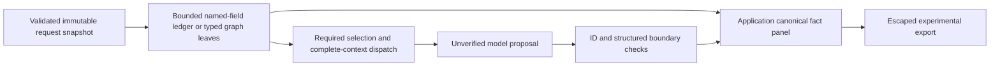

# Sprint 11 source-to-report audit (before implementation/inference)

All new examples are synthetic. Caller assertions are not independent observations
of a real deployment. The opt-in proof has no public route or production switch.

| Pillar / transitions | Current deterministic owner/control | Model-owned risk / dropped fields | Destination / failure |
| --- | --- | --- | --- |
| SOC: `SocAlertRequest` -> `microsoft_evidence` -> `build_soc_prompt` -> `analyze_soc_alert` -> `_process_output` / `validate_soc_output` | Pydantic bounds; `soc_inputs.parse_json_bundle` validates case/row format; `MicrosoftEvidence.inventory` names rows/fields; original raw JSON remains; `output_policy` checks explicit observables/endpoints, one repair | Named telemetry inventory excludes unnamed columns. Ledger has 64 facts, 1024 chars/value, 24KB and visible omissions; off by default. Model can omit outcome, timestamp/PID, count/approval scope or invent tactics despite valid endpoints | `SocAlertResponse` / `main._run_soc` binds alert identity; `dashboard.exports.export_document` binds case metadata, other analysis remains model prose. Inspector/corrections retain original/revision history. Invalid output withheld after one repair |
| Governance: `GovernanceRiskRequest` -> `build_governance_prompt` / `format_guidance_for_prompt` -> `analyze_governance_risk` -> source sanitation | Input bounds; full input prompt, source membership/provenance restoration; ledger retains exact whole fields with supplied/unknown state only | No arbitrary-prose control-state parser. Model owns risk/decision, can reverse unknown/absent, lose quantitative sample or broaden policy review scope. Named output `required_controls` is not organizational authority | `GovernanceRiskResponse`; exports bind system name from input but risks/requirements remain model text. Pydantic/source errors fail. No canonical field panel today |
| AI Security: `AiSecurityRequest.graph_integrity` -> `analyze_ai_security` -> compact `candidate_schema` -> reference/category gates -> `make_envelope` | Unique IDs, graph endpoints/tool/control references, size limits; minimum structural reviewability; Python case identity/purpose/counts; application guidance eligibility and provenance | Model owns candidate content and can omit controls, misread pre/post-action gate or invent supported-looking risks. Category/flow membership is necessary, not semantic proof. 400-char source fields, 28KB prompt/24KB output caps | Read-only envelope/provenance; no organizational retrieval/correction editing. Reference/category violation withholds whole advisory. App-copied summary does not demonstrate model recall |
| Shared retrieval -> inference -> export | `retrieval.orchestration.retrieve_for_analysis` filters configured workflow/scope/version via eligible retrieval before serialization; `serialization.metadata` is app-owned; body untrusted. Fail closed on configured retrieval errors | A citation may be eligible but irrelevant or non-entailing. Ranking gives no policy authority; no authenticated multi-user IAM. Legacy default retained | Sources restored to app metadata; body cannot grant authority. This proof **does not ingest reviewed documents or claim exact reviewed-source spans**; unsupported external-source projection fails |

## Nine exact complete fact chains

Each chain is source -> immutable pointer/value -> actual counted-client dispatch ->
application-owned panel -> JSON/escaped Markdown export. Existing controls stop
structural corruption; the new proof addresses model-owned recitation loss. Every
fixture's `expected_facts` records exact paths/values/scope and both mandatory
requirements. All other topics/categories are explicitly unassessed.

| Chain | Synthetic source paths | Current control; current risk |
| --- | --- | --- |
| S1 outcome/time | LARCH-SOC-TRANSFER `raw_log.tables.DeviceNetworkEvents[0].ActionType`, `.Timestamp` | Typed row pointer / case check; success can be retold as theft or completion |
| S2 role/endpoint/process | Both SOC cases `.LocalIP`, `.LocalPort`, `.RemoteIP`, `.RemotePort`, `.InitiatingProcessFileName`, `.InitiatingProcessId` | Named roles/endpoint guard; PID/roles can be omitted in prose |
| S3 count/authorization | LARCH-SOC-MAINTENANCE `observed_behavior`: LC-48, exactly two checks, 14:20–14:25, one failed row, no containment | Exact whole-field span; no prose parser. Model can expand scope or confuse attempted/completed |
| G1 control state | LARCH-GOVERNANCE-GAP `human_review_process`: proposed/not implemented, automatic delivery reported implemented, retention unknown | Exact source field, supplied assertion; model can promote/reverse state |
| G2 sample evidence | Both governance `human_review_process`: two of six bypass, four waited; nine of nine held | Whole-field provenance; sample omission can erase counterevidence |
| G3 narrow review/approval | BOUNDED `human_review_process` LC-R8 external-only; `business_impact` LC-A8 one rehearsal/nine drafts | Exact fields distinguish policy assertion and approval scope; model may broaden rule or grant rollout |
| A1 graph identity | AI cases `components[*].id/kind`, `flows[*].id/source_id/target_id` | Existing graph validator; model may name wrong endpoints |
| A2 classification/capability | `flows[*].classification`, `tools[0].capabilities`, `.human_gate` | Declared typed values, not tested operations; model may invent private data or writes on read-only utility |
| A3 control/oversight timing | `controls[0].description/claimed_status`, `human_oversight[0]`, `implementation_evidence` | Exact claims and empty declaration, not verified absence; post-tool display cannot undo a write, model can confuse timing |

## Selection, trust and falsification contract

`MUST_INCLUDE_IN_MODEL_CONTEXT` and `MUST_BIND_IN_REPORT` apply to every selected
original leaf and named telemetry field in the small proof; no selective removal
of exculpatory facts. `OPTIONAL_CONTEXT` is an explicit supported requirement for
future selection, with counted gaps, but not used to hide a required fixture fact.
Unparsed prose is preserved as a whole exact field, with semantics unassessed.
The ledger's omitted raw container is recoverable only from the canonical raw_log
field; unsupported/missing required projections cause visible unavailability.

Trusted internal policy permits only public synthetic demonstration input here.
Unknown/sensitive required classification is denied; the helper cannot authenticate
that a caller's synthetic label is true. No filesystem retrieval or source-body
metadata grants. Hashes identify snapshots/correlation, not authenticity/anonymity.
Proof source versions equal validated snapshot hash; stale/mutated refs, duplicate
IDs, missing/oversized values, malformed/conflicting row identity, illegal graph,
source-ID injection and report mutation must fail. Prose contradictions cannot be
generally decided: attributed proposal text stays unverified and human-reviewed.

Offline tests include missing/malformed and hostile/contradictory cases per pillar;
fake counted-client tests inspect **actual dispatched messages**, then export a
report whose facts were never copied from model output. Deliberately false model
restatements may remain in the separately labeled interpretation: panel integrity
does not turn that interpretation into a pass. Public API/UI/export/corrections
remain their existing contracts, covered separately by regression mocks.
